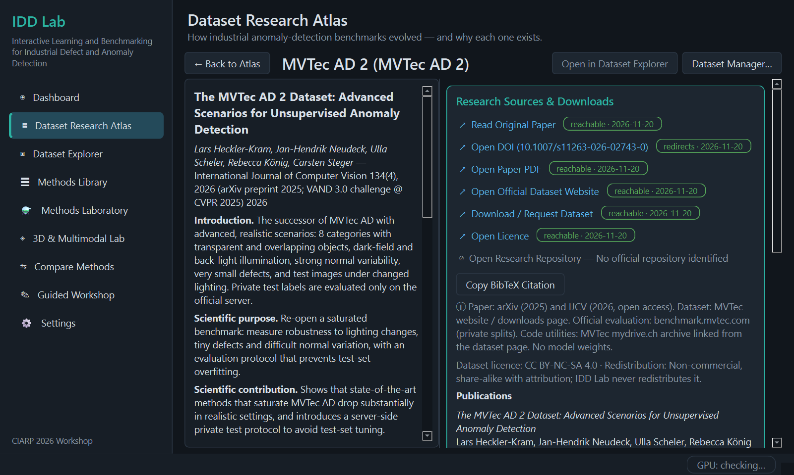

# Industrial Defect Detection Lab (IDD Lab)

**An interactive desktop application for learning industrial defect detection, visual anomaly
detection, 3D inspection and multimodal AI — with real implementations, traceable science and
hands-on exercises.**

IDD Lab was developed for the CIARP 2026 workshop **"Industrial Defect Detection and Anomaly Analysis
using Computer Vision, Multimodal Imaging, and AI"** (Mexico City) and is designed to remain useful as
teaching material afterwards.

> **Status: pre-release.** The licence for the project's own code is proposed (Apache-2.0) but
> **not yet applied** — see [Licence](#licence). No datasets or model weights are distributed.

> **Disclaimer.** IDD Lab is a personal, independent educational initiative. It is not an official
> product of, and is not endorsed by, any institution, company, dataset provider or the conference
> organisers.



## Contents
- [What the application does](#what-the-application-does)
- [Anomaly detection methods](#anomaly-detection-methods)
- [Datasets](#datasets)
- [2D and 3D features](#2d-and-3d-features)
- [Installation](#installation)
- [Exercises and the CIARP 2026 workshop](#exercises-and-the-ciarp-2026-workshop)
- [Scientific references](#scientific-references)
- [Evaluation principles](#evaluation-principles)
- [Repository structure](#repository-structure)
- [Licence](#licence)

## What the application does
IDD Lab is a PySide6 (Qt for Python) desktop application with an English and Spanish interface. It
combines a research atlas, a methods library and a laboratory in which every runnable method executes
its actual implementation (OpenCV, scikit-image, Anomalib, Open3D) on CPU or GPU.

| Page | Purpose |
|---|---|
| **Start Learning** | 9 guided topics, from image basics to deployment decisions: explanation, example, scientific background, in-app demos, exercise, reflection questions, papers and code |
| **Dataset Research Atlas** | Timeline, gallery, filters, comparison table and scientific profiles of 8 industrial benchmarks, with links to papers, DOIs, official download pages and licences — works offline |
| **Dataset Explorer** | Browse normal and defective samples, ground-truth overlays, pixel inspection, export with attribution; point clouds |
| **Methods Library** | 23 methods in 7 families, each with references, source code and a step-by-step *How This Algorithm Works* |
| **Methods Laboratory** | Fit on normal images, calibrate a threshold on unused normal images, run, re-threshold and evaluate |
| **3D & Multimodal Lab** | Point-cloud registration and geometric deviation, synchronised RGB · infrared · 3D viewer, late fusion |
| **Compare Methods** | Several methods on the same image with a calibrated, comparable scale |
| **Educational Experiments** | Resolution and geometry, illumination robustness, *Understanding Evaluation Metrics* |
| **Model Manager** | Per method: implementation, references, weight licence, CPU/GPU support, installed status, explicit download |
| **Guided Workshop** | Timed workshop activities with real, verified results |

### Two editions, one codebase
| | **Student Edition** | **Instructor Edition** |
|---|---|---|
| Setup | `setup_student.ps1` (*core* or *full* profile) | `setup.ps1` (full CUDA environment) |
| Without datasets or models | Atlas, Methods Library, Start Learning, synthetic demos, stored verified results | — |
| Real datasets | Optional, imported from the official sources | Installed locally by the instructor |
| Deep learning | *Full* profile (CPU or CUDA), after downloading backbones and fitting | Verified fitted checkpoints, GPU |

The edition is detected automatically and can be changed in *Settings → General → Edition*.

## Anomaly detection methods
**Runnable — core profile (no PyTorch):** Otsu thresholding, adaptive thresholding, Canny edges, Gabor
texture filters, morphology, reference difference, SSIM.

**Runnable — full profile (via Anomalib 2.7.1):** PaDiM, PatchCore, EfficientAD, AnomalyDINO and WinCLIP
(zero-shot, CLIP-based); 3D registration with geometric deviation; multimodal late fusion.

**Explained, not executed:** CNN / YOLO / U-Net supervised detection and segmentation, autoencoders,
DRAEM, Dinomaly, DINOv2/DINOv3 features, M3DM, Reg3D-AD.

Pretrained backbones are downloaded only after an explicit user action (Model Manager or
`prepare_models.ps1`), from the original source, with source, size and licence shown first. See
[METHODS.md](METHODS.md).

## Datasets
**IDD Lab never redistributes datasets.** It works without any: on first run it generates *Synthetic
Educational Data — Not a Real Industrial Benchmark* locally with a fixed seed. Real datasets are
downloaded by the user from their official sources (subject to their licences) and imported in
*Settings → Dataset Manager*.

Benchmarks profiled in the Atlas: MVTec AD, MVTec LOCO AD, VisA, Real3D-AD, MVTec AD 2, MulSen-AD,
Real-IAD D3 and 3D-ADAM. Import adapters, access conditions and licences: [DATASETS.md](DATASETS.md).

Results computed with third-party datasets that appear in the application (e.g. on MVTec AD 2) are
labelled *local educational* results, carry attribution, and are never presented as official benchmark
numbers.

## 2D and 3D features
- **2D:** sample browsing with ground-truth overlays, classical image processing, feature-based anomaly
  maps, threshold calibration on normal images, image and pixel metrics (AUROC, AP, AU-PRO, pixel F1,
  Dice / IoU), side-by-side comparison, resolution and illumination experiments.
- **3D and multimodal:** point-cloud viewing, registration (ICP) and geometric deviation maps,
  synchronised RGB / infrared / 3D views and late fusion (full profile, Open3D).

## Installation
Windows 10/11 (64-bit), Python 3.11–3.13 (3.12 recommended), no administrator rights required.
Use a **short folder path** (Windows path-length limit for Qt files).

```powershell
git clone https://github.com/edelgr/industrial-defect-detection-lab.git C:\IDD_Lab
cd C:\IDD_Lab
Set-ExecutionPolicy -Scope Process -ExecutionPolicy Bypass
.\setup_student.ps1                 # core profile (~0.8 GB environment, no PyTorch)
.\setup_student.ps1 -Profile full   # + deep learning and 3D; CPU or CUDA PyTorch chosen from the NVIDIA driver
.\start.ps1
```

Offline installation check: `.\.venv\Scripts\python.exe -m scripts.readiness --profile student`.

| Requirement | Core profile | Full profile |
|---|---|---|
| RAM | 8 GB | 16 GB recommended |
| Disk | ≈ 1 GB | ≈ 3–6 GB + optional weights (≤ 1.2 GB) and datasets |
| GPU | not needed | optional NVIDIA GPU, driver ≥ 580 for the CUDA build |
| Display | ≥ 1280 px wide | ≥ 1280 px wide |

Details and the instructor installation: [INSTALL_WINDOWS.md](INSTALL_WINDOWS.md) ·
first steps: [STUDENT_QUICK_START.md](STUDENT_QUICK_START.md) ·
problems: [TROUBLESHOOTING.md](TROUBLESHOOTING.md).

## Exercises and the CIARP 2026 workshop
Eight exercise sheets run on the Student Edition, most of them without any dataset:

1. [Classical Defect Detection](docs/exercises/EXERCISE_1_CLASSICAL.md)
2. [Understanding PatchCore](docs/exercises/EXERCISE_2_PATCHCORE.md)
3. [Comparing Anomaly Detection Algorithms](docs/exercises/EXERCISE_3_COMPARING.md)
4. [Resolution Matters](docs/exercises/EXERCISE_4_RESOLUTION.md)
5. [Illumination Robustness](docs/exercises/EXERCISE_5_ILLUMINATION.md)
6. [Understanding Evaluation Metrics](docs/exercises/EXERCISE_6_METRICS.md)
7. [Multimodal Anomaly Detection](docs/exercises/EXERCISE_7_MULTIMODAL.md)
8. [Industrial Decision Making](docs/exercises/EXERCISE_8_DECISIONS.md)

Workshop materials are collected in [workshop/CIARP2026/](workshop/CIARP2026/README.md):
[participant guide](workshop/CIARP2026/guide/PARTICIPANT_GUIDE.md),
[instructor guide](workshop/CIARP2026/guide/INSTRUCTOR_GUIDE.md),
[exercise index](workshop/CIARP2026/exercises/README.md),
[references](workshop/CIARP2026/references/README.md) and
[slides](workshop/CIARP2026/slides/README.md) (the presentation will be added from its original file).

## Scientific references
Every dataset and method in the application links to its original paper, DOI or arXiv entry, open PDF
when available, the authors' repository, the implementation actually used and the dataset access page.
BibTeX can be copied offline.

- Full catalog: [RESEARCH_REFERENCES.md](RESEARCH_REFERENCES.md) · [CITATIONS.bib](CITATIONS.bib) · `research_catalog/`
- Workshop subset: [workshop/CIARP2026/references/](workshop/CIARP2026/references/README.md)

Core references include MVTec AD (Bergmann et al., CVPR 2019 / IJCV 2021), MVTec AD 2 (Heckler-Kram et
al., IJCV 2026), PaDiM (Defard et al., ICPR Workshops 2021), PatchCore (Roth et al., CVPR 2022),
EfficientAD (Batzner et al., WACV 2024), AnomalyDINO (Damm et al., WACV 2025), WinCLIP (Jeong et al.,
CVPR 2023), MulSen-AD (Li et al., CVPR 2025) and Anomalib (Akcay et al., ICIP 2022).

## Evaluation principles
Models are fitted only on normal training images; thresholds are chosen only on normal images not used
for fitting; evaluation uses only public labelled test splits (MVTec AD 2 private splits are never
evaluated). Results are labelled *published*, *reproduced*, *local educational* or *synthetic
demonstration* and never mixed. See [EXPERIMENT_PROTOCOLS.md](EXPERIMENT_PROTOCOLS.md).

## Repository structure
```
app/                 Qt user interface (pages, widgets, translations)
core/                datasets, algorithms, inference, evaluation, model registry, profiles
research_catalog/    verified metadata for datasets, methods and publications
education/           learning topics (EN/ES) and diagrams
docs/                exercises, audits, licensing, distribution and release documents
workshop/CIARP2026/  workshop guides, exercise index, references, slides (pending)
configs/             verified workshop presets (results only, no weights)
requirements/        pinned dependency locks for the Student Edition
scripts/             readiness, documentation checks, release staging, Qt flow checks
tests/               automated tests (pytest)
data/, checkpoints/, experiments/   placeholders only — filled locally, never committed
```

Architecture: [ARCHITECTURE.md](ARCHITECTURE.md) · contributing: [CONTRIBUTING.md](CONTRIBUTING.md) ·
changes: [CHANGELOG.md](CHANGELOG.md).

## Licence
**No licence has been applied yet.** Until one is applied, all rights are reserved by the author.

- Proposed for the project's own code and documentation: **Apache-2.0** — prepared in
  [docs/licensing/LICENSE-Apache-2.0.proposed.txt](docs/licensing/LICENSE-Apache-2.0.proposed.txt) and
  [NOTICE.proposed](NOTICE.proposed), to be applied once the right to license every affected component
  is confirmed ([docs/PUBLICATION_READINESS.md](docs/PUBLICATION_READINESS.md)).
- The workshop presentation will be reviewed and licensed separately
  ([docs/licensing/IP_AND_ATTRIBUTION_REVIEW.md](docs/licensing/IP_AND_ATTRIBUTION_REVIEW.md)).
- Third-party software is installed by the user and keeps its own licence:
  [THIRD_PARTY_NOTICES.md](THIRD_PARTY_NOTICES.md). Datasets and model weights are not included and keep
  their own terms: [docs/LICENSE_AUDIT.md](docs/LICENSE_AUDIT.md),
  [docs/REDISTRIBUTION_POLICY.md](docs/REDISTRIBUTION_POLICY.md).
