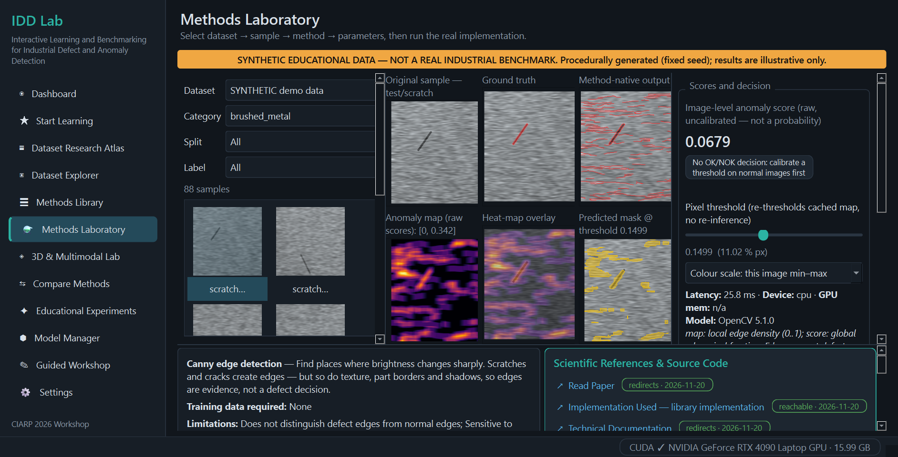
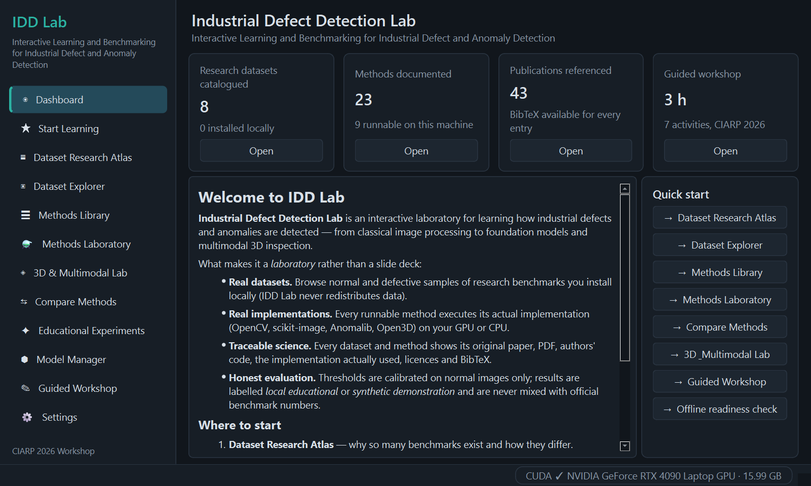
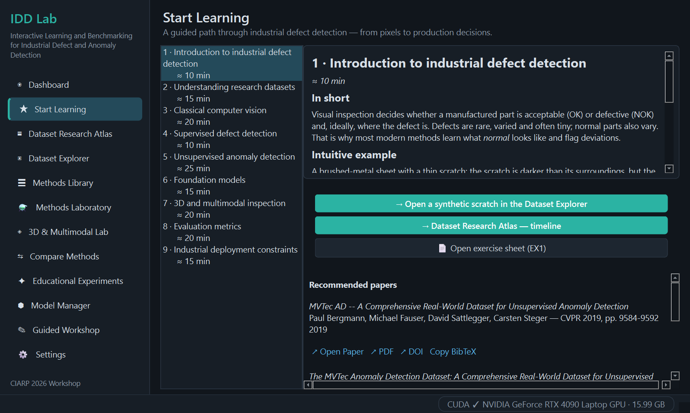
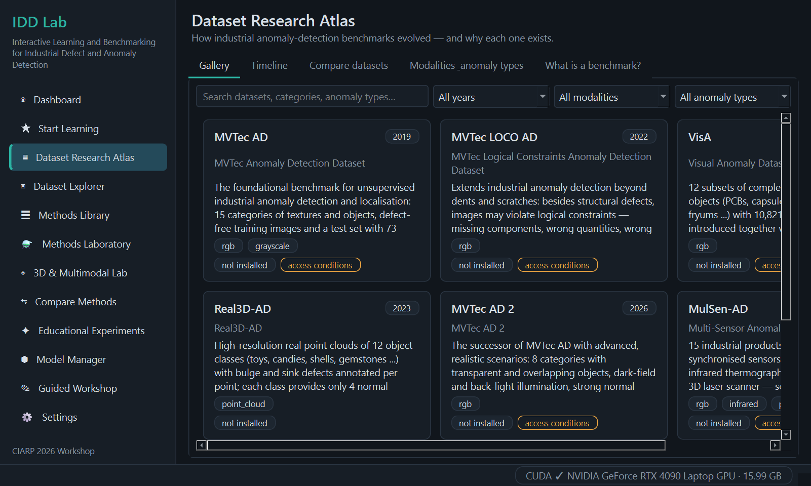
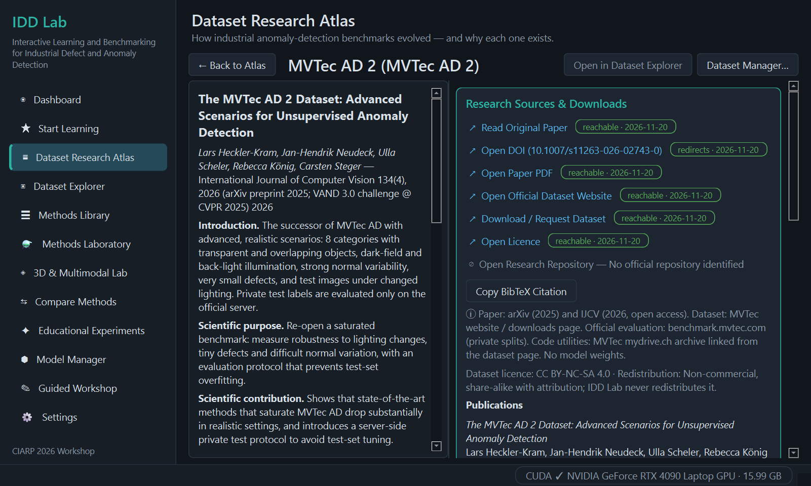
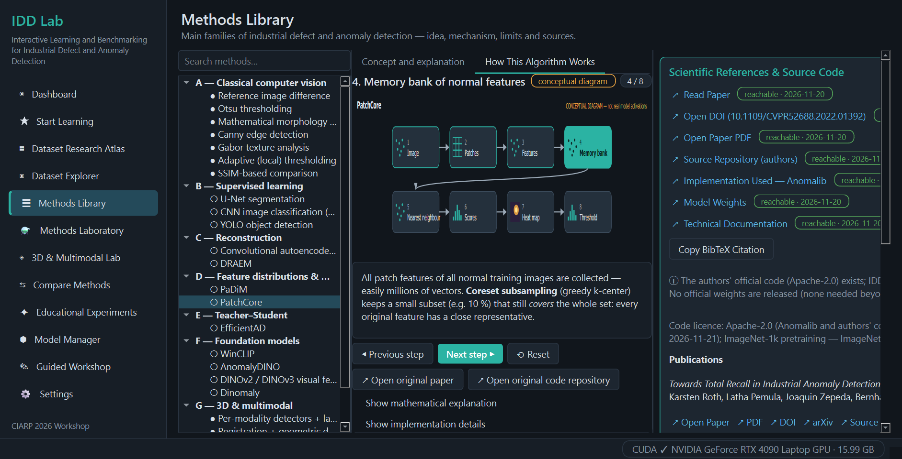
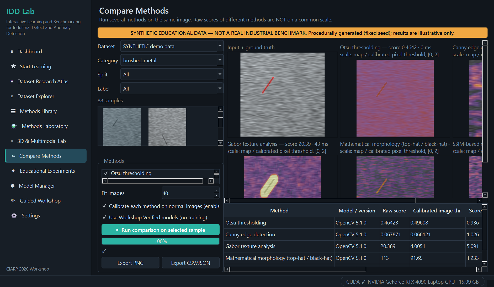
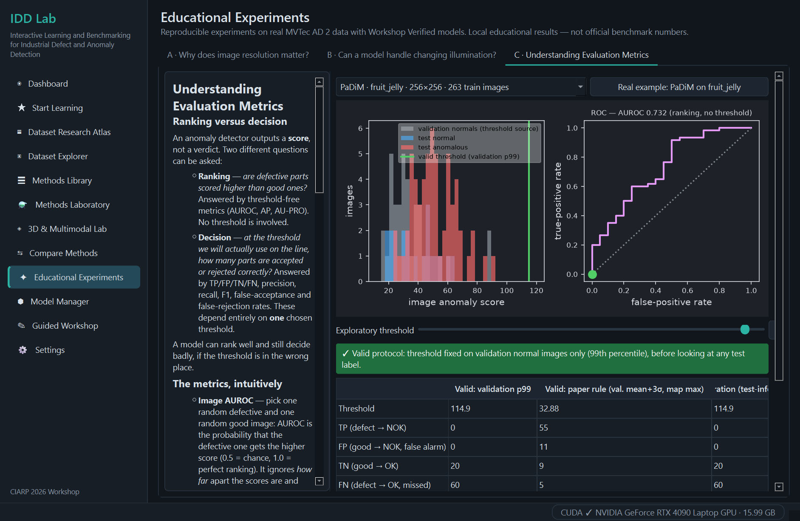
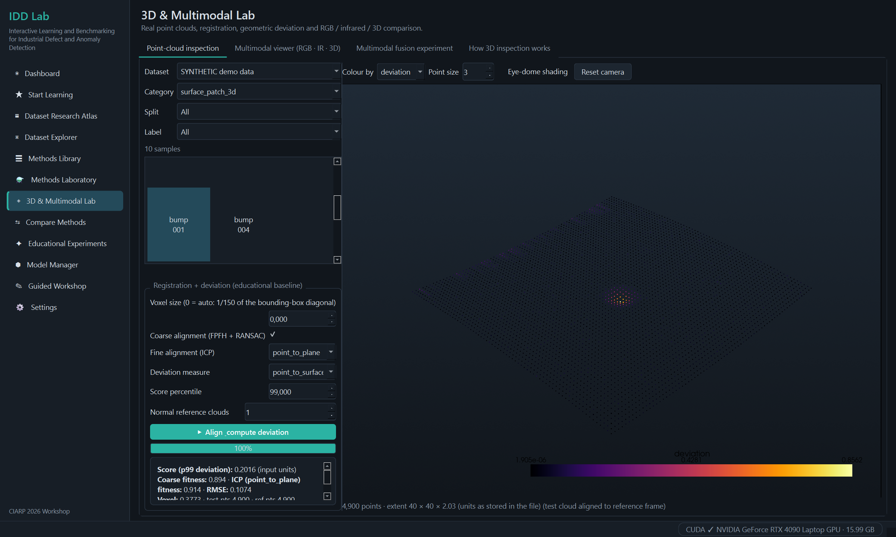
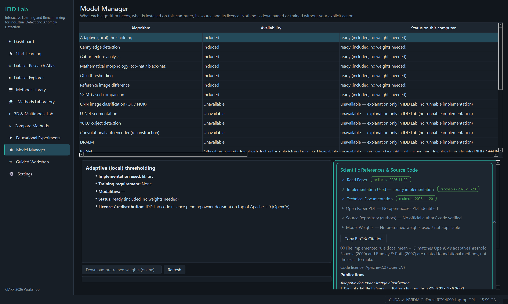

# Industrial Defect Detection Lab (IDD Lab)

*Interactive Learning and Benchmarking for Industrial Defect and Anomaly Detection.*

IDD Lab is a desktop application, written in Python with Qt (PySide6), for **learning and experimenting
with modern industrial visual inspection**. Every runnable method executes its real implementation
(OpenCV, scikit-image, Anomalib, Open3D) on your own computer, and every dataset and method is linked
to its original paper, code and licence.

> **Status: pre-release.** The repository is private and no licence has been applied yet (see
> [License and Attribution](#16-license-and-attribution)). IDD Lab is a personal, independent
> educational initiative; it is not an official product of, or endorsed by, any institution, company,
> dataset provider or conference.



## Contents
1. [Project Overview](#1-project-overview)
2. [System Requirements](#2-system-requirements)
3. [Download & Installation](#3-download--installation)
4. [How to Run IDD Lab](#4-how-to-run-idd-lab)
5. [Your First Experiment](#5-your-first-experiment)
6. [Key Features](#6-key-features)
7. [Application Screenshots](#7-application-screenshots)
8. [Detection Methods](#8-detection-methods)
9. [Research Datasets](#9-research-datasets)
10. [Adding Research Datasets](#10-adding-research-datasets)
11. [Models and Checkpoints](#11-models-and-checkpoints)
12. [CIARP 2026 Workshop](#12-ciarp-2026-workshop)
13. [Architecture and Technologies](#13-architecture-and-technologies)
14. [Scientific References](#14-scientific-references)
15. [Troubleshooting](#15-troubleshooting)
16. [License and Attribution](#16-license-and-attribution)

---

## 1. Project Overview

Industrial inspection must decide whether a manufactured part is acceptable (OK) or defective (NOK), and
ideally where the defect is. Defects are rare, varied and often tiny, while normal parts also vary —
which is why most modern methods learn what *normal* looks like and flag deviations. IDD Lab lets
students, researchers and engineers explore this field hands-on, combining:

| Area | In IDD Lab |
|---|---|
| **Classical computer vision** | Thresholding, edges, texture filters, morphology, reference comparison |
| **Deep learning** | Pretrained CNN features (ResNet, Wide-ResNet) for anomaly detection |
| **Unsupervised anomaly detection** | PaDiM, PatchCore, EfficientAD — trained on normal images only |
| **Foundation models** | AnomalyDINO (DINOv2) and WinCLIP (CLIP, zero-shot) |
| **3D computer vision** | Point-cloud registration (FPFH + RANSAC, ICP) and geometric deviation |
| **Multimodal inspection** | Synchronised RGB · infrared · 3D views and late score fusion |
| **Scientific benchmarking** | Protocol-correct thresholds, AUROC / AP / AU-PRO / F1, labelled result provenance |

**Educational value.** The application explains *why* a method works, shows its intermediate steps,
and makes the gap between research benchmarks and production decisions visible: thresholds are chosen
on normal images only, raw scores are never presented as probabilities, and every result is labelled
*published*, *reproduced*, *local educational* or *synthetic demonstration*. The interface is
available in English and Spanish.

## 2. System Requirements

| | **Student Core** | **Student Full — CPU** | **Student Full — CUDA** |
|---|---|---|---|
| Operating system | Windows 10 / 11, 64-bit | Windows 10 / 11, 64-bit | Windows 10 / 11, 64-bit |
| Python | 3.11, 3.12 or 3.13 (3.12 recommended), from python.org | same | same |
| CPU | 64-bit x86 (Intel / AMD) | 64-bit x86; deep methods run, but slower | 64-bit x86 |
| RAM | 8 GB | 16 GB recommended | 16 GB recommended |
| Free disk space (checked by the setup) | ≥ 7 GB (environment ≈ 0.7 GB, measured) | ≥ 13 GB (environment ≈ 3 GB) | ≥ 13 GB (environment ≈ 6 GB) |
| GPU | not used | not used | NVIDIA GPU with driver **≥ 580** (PyTorch CUDA 13.0 build) |
| Display | ≥ 1280 px wide | ≥ 1280 px wide | ≥ 1280 px wide |
| Internet | during installation only | installation; optional weight / dataset downloads | same as CPU |
| Administrator rights | not needed | not needed | not needed |

- **Student Core** — no PyTorch. Start Learning, Dataset Research Atlas, Methods Library, Dataset
  Explorer, all classical methods, metrics, synthetic data, stored verified results, Guided Workshop.
- **Student Full CPU** — adds PyTorch 2.14.1 (CPU build), Anomalib, Open3D and PyVista: PaDiM, PatchCore,
  AnomalyDINO, WinCLIP and the 3D & Multimodal Lab. EfficientAD's 10 000-step training is impractical
  on a CPU (stored results are used instead).
- **Student Full CUDA** — the same, with GPU acceleration. The setup installs the CUDA build only when
  it detects an NVIDIA driver ≥ 580; a CUDA build is never installed just because a GPU is present.

Optional pretrained weights take up to ≈ 1.2 GB; datasets are separate and optional. Full comparison:
[INSTALL_WINDOWS.md](INSTALL_WINDOWS.md).

## 3. Download & Installation

> **Use a short folder path**, for example `C:\IDD_Lab`. Qt for Python contains files about 140
> characters below `site-packages`; without Windows *Long Path* support the full path must stay under
> 260 characters. The setup checks this before installing anything.

First install **Python 3.12** from <https://www.python.org/downloads/windows/> and tick
*Add python.exe to PATH*.

### Option A — Download ZIP
1. Open the repository page on GitHub: <https://github.com/edelgr/industrial-defect-detection-lab>.
2. Click **Code** → **Download ZIP**.
3. Extract the ZIP. It contains a folder `industrial-defect-detection-lab-main`; move or rename it to a
   short path such as `C:\IDD_Lab`.
4. Open that folder in File Explorer, then open PowerShell there (*File → Open Windows PowerShell*, or
   type `powershell` in the address bar and press Enter).

### Option B — Git clone
```powershell
git clone https://github.com/edelgr/industrial-defect-detection-lab.git C:\IDD_Lab
cd C:\IDD_Lab
```
(Without the target folder, `git clone` creates `industrial-defect-detection-lab` in the current
directory; any short location works.)

> The repository is currently **private**: both options work for invited collaborators and will work
> for everyone once the repository is made public.

### Install the application (once)
In PowerShell, inside the IDD Lab folder, allow scripts **for this PowerShell window only** and run the
setup for the profile you want:

```powershell
Set-ExecutionPolicy -Scope Process -ExecutionPolicy Bypass   # affects this window only

.\setup_student.ps1                          # Student Core (default)
.\setup_student.ps1 -Profile full            # Student Full: CPU or CUDA chosen from your NVIDIA driver
.\setup_student.ps1 -Profile full -Torch cpu # Student Full, force the CPU build
```

Equivalent one-line form, which changes nothing outside that command:
```powershell
powershell -NoProfile -ExecutionPolicy Bypass -File .\setup_student.ps1 -Profile full
```

The script runs ten steps: detect Python → verify the version → check disk space and path length →
detect the NVIDIA GPU / driver → choose the PyTorch build (full profile) → create a private virtual
environment `.venv` → install pinned dependencies from `requirements/` → validate the imports →
generate the Synthetic Educational Data → run an offline readiness check. Options (all verified in
`setup_student.ps1`): `-Profile core|full`, `-Torch auto|cpu|cu130|cu128`, `-Python <path to python.exe>`,
`-VenvDir <folder>`, `-SkipReadiness`.

**It finished correctly** when the last lines read `IDD Lab Student Edition is ready.` You can repeat
the check at any time:
```powershell
.\.venv\Scripts\python.exe -m scripts.readiness --profile student   # "0 required failing", exit code 0
```

The setup downloads Python packages only. It does **not** download datasets or pretrained weights and
never deletes anything; running it again re-uses the existing `.venv`.

## 4. How to Run IDD Lab

Installation is done **once**. After that, every time you want to use IDD Lab:

1. Open the folder where you installed IDD Lab (e.g. `C:\IDD_Lab`).
2. Open PowerShell in that folder.
3. Run:
   ```powershell
   .\start.ps1
   ```

If PowerShell refuses to run scripts in a new window, use either of these instead:
```powershell
powershell -NoProfile -ExecutionPolicy Bypass -File .\start.ps1
.\.venv\Scripts\python.exe -m app.main        # direct start with the environment's Python
```

To **close** IDD Lab, close its window (or press *Alt+F4*). The application cancels and waits for its
background tasks before exiting; close the window before closing PowerShell.

Good to know:
- You do **not** need to run `setup_student.ps1` again to start the application.
- You do **not** need VS Code, Claude Code or any other development tool.
- You do **not** need an Internet connection to use the local content (catalog, explanations,
  exercises, synthetic data, stored results, installed datasets and cached models). Scientific links
  open in your browser when a connection is available.

## 5. Your First Experiment

About 15 minutes; no GPU, no pretrained model and no external dataset needed.

1. **Open IDD Lab** with `.\start.ps1`. On a student computer a first-run assistant shows what your
   computer can do; choose **Start Learning**.
2. **Choose the language** (optional): *Settings → General → Language* → *English* or *Español* →
   **Save**, then restart IDD Lab.
3. In **Start Learning**, open *1 · Introduction to industrial defect detection* and read *In short*;
   click **Open a synthetic scratch in the Dataset Explorer** to see a defective sample and its
   ground-truth mask.
4. Go to **Methods Laboratory**. Select Dataset **SYNTHETIC demo data**, Category **brushed_metal**,
   Label **Defective**, and click a *scratch* sample.
5. Choose the method **Canny edge detection** (or **Otsu thresholding**) and click
   **▶ Run on selected sample**.
6. **Change one parameter** — for Canny, raise the *High hysteresis threshold* (default 120) — and run
   again.
7. **Compare the images**: original, ground truth, method-native output (edges), anomaly map, heat-map
   overlay and predicted mask. Move the *Pixel threshold* slider: the cached map is re-thresholded
   without running the method again.
8. **Interpret the result**: the raw image score is *uncalibrated — not a probability*; edges appear
   on the scratch but also on the normal brushed texture, so edges are evidence, not a defect decision.
   Every view carries the banner *Synthetic Educational Data — Not a Real Industrial Benchmark*.
9. **Read the explanation** below the images (idea, training data required, limitations, references),
   or open **Methods Library → A — Classical computer vision → Canny edge detection**.

Continue with [Exercise 1 — Classical Defect Detection](docs/exercises/EXERCISE_1_CLASSICAL.md) and
[STUDENT_QUICK_START.md](STUDENT_QUICK_START.md).

## 6. Key Features

| Module | What it is for |
|---|---|
| **Start Learning** | Nine guided topics (≈ 10–25 min each), from the basics to industrial deployment constraints: short explanation, intuitive example, scientific background, buttons that open the relevant demo, exercise sheet, reflection questions, recommended papers |
| **Dataset Research Atlas** | Understand *why* so many benchmarks exist: timeline, gallery, filters, side-by-side comparison and a scientific profile of eight datasets (purpose, protocol, challenges, limitations), with links to papers, official pages and licences — works offline |
| **Dataset Explorer** | Browse normal and defective samples, overlay ground truth, inspect pixel values and sample metadata, view point clouds, export a view with attribution |
| **Methods Library** | 23 methods in 7 families: concept, limitations, *How This Algorithm Works* step-by-step diagrams, optional mathematical and implementation details, references and source code |
| **Methods Laboratory** | Run a method on one sample, see every intermediate output, fit deep models on normal images, calibrate thresholds on normal images only, re-threshold and evaluate on a test split |
| **3D & Multimodal Lab** | Align a test point cloud to normal references and colour it by geometric deviation; compare RGB, infrared and 3D of the same object; run a late-fusion experiment |
| **Compare Methods** | Run several methods on the same image, with each score divided by its own calibrated threshold so that results become comparable |
| **Educational Experiments** | A · image resolution, B · illumination robustness, C · *Understanding Evaluation Metrics* (ranking versus decision) — live when the dataset and models are present, otherwise clearly labelled **stored results** |
| **Model Manager** | For every algorithm: implementation, availability on this computer, weight source, size and licence, CPU/GPU support, and an explicit download action |
| **Guided Workshop** | The timed CIARP 2026 activities with objectives, instructions, expected observations and real, verified results |

## 7. Application Screenshots

All screenshots show the real application with catalog content, the **Synthetic Educational Data**
or stored metric plots — no images from third-party datasets.

| | |
|---|---|
|  **Dashboard** |  **Start Learning** |
|  **Dataset Research Atlas** |  **Dataset profile and research sources** |
|  **Methods Library — How This Algorithm Works** |  **Methods Laboratory** |
|  **Compare Methods** |  **Educational Experiments — metrics** ¹ |
|  **3D & Multimodal Lab** (synthetic surface patch) |  **Model Manager** |

¹ Stored score histograms and ROC curve of a PaDiM model evaluated locally on MVTec AD 2 `fruit_jelly`
(dataset: MVTec Software GmbH, CC BY-NC-SA 4.0). Local educational result, not an official benchmark
number. Screenshots were taken on the development computer; the status bar shows its GPU.

## 8. Detection Methods

**Runnable** = executes on your computer · **Requires fitting / weights** = runnable after downloading
pretrained weights and fitting on normal images (full profile) · **Explanation only** = documented in the
Methods Library, no executable implementation.

| Family | Method | Implementation | Status |
|---|---|---|---|
| A — Classical computer vision | Otsu thresholding | OpenCV | Runnable (core) |
| | Adaptive (local) thresholding | OpenCV | Runnable (core) |
| | Canny edge detection | OpenCV + edge-density map | Runnable (core) |
| | Gabor texture analysis | OpenCV filter bank + robust z-score | Runnable (core) |
| | Mathematical morphology (top-hat / black-hat) | OpenCV | Runnable (core) |
| | Reference image difference | ECC alignment + absolute difference | Runnable (core) |
| | SSIM-based comparison | scikit-image | Runnable (core) |
| B — Supervised learning | CNN classification, U-Net segmentation, YOLO detection | — | Explanation only |
| C — Reconstruction | Convolutional autoencoder, DRAEM | — | Explanation only |
| D — Feature distributions & memory banks | **PaDiM** (ResNet-18) | Anomalib 2.7.1 | Requires fitting / weights (full) |
| | **PatchCore** (Wide-ResNet-50-2) | Anomalib 2.7.1 | Requires fitting / weights (full) |
| E — Teacher–student | **EfficientAD** | Anomalib 2.7.1 + IDD Lab training loop | Requires training / weights (full; GPU recommended) |
| F — Foundation models | **AnomalyDINO** (DINOv2 ViT-S/14, few-shot) | Anomalib 2.7.1 | Requires fitting / weights (full) |
| | **WinCLIP** (OpenCLIP ViT-B-16-plus-240, zero/few-shot) | Anomalib 2.7.1 | Requires pretrained weights (full) |
| | Dinomaly, DINOv2/DINOv3 features | — | Explanation only |
| G — 3D & multimodal | **Registration + geometric deviation** | Open3D (FPFH + RANSAC, ICP) — IDD Lab educational baseline | Runnable (full); works on synthetic 3D patches |
| | **Multimodal late fusion** | Per-modality detectors + 3D baseline, z-score fusion — IDD Lab educational | Runnable (full) with MulSen-AD and fitted models |
| | M3DM, Reg3D-AD | — | Explanation only |

Details, implementation notes and licences: [METHODS.md](METHODS.md) ·
references: [Scientific References](#14-scientific-references).

## 9. Research Datasets

**No dataset is included in this repository.** IDD Lab works without any dataset (it generates the
Synthetic Educational Data locally) and imports real datasets that you download from their official
sources. All eight datasets are documented in the Atlas; five have working import adapters.

| Dataset | Year | Modalities | Licence | Adapter | Official page |
|---|---|---|---|---|---|
| MVTec AD | 2019 | RGB / grey | CC BY-NC-SA 4.0 | ✓ | [mvtec.com](https://www.mvtec.com/research-teaching/datasets/mvtec-ad) |
| MVTec LOCO AD | 2022 | RGB | CC BY-NC-SA 4.0 | ✓ | [mvtec.com](https://www.mvtec.com/research-teaching/datasets/mvtec-loco-ad) |
| VisA | 2022 | RGB | CC BY 4.0 | Atlas only | [AWS Open Data](https://registry.opendata.aws/visa/) |
| Real3D-AD | 2023 | point cloud | CC BY 4.0 (data) | ✓ | [GitHub](https://github.com/M-3LAB/Real3D-AD) |
| MVTec AD 2 | 2025/26 | RGB | CC BY-NC-SA 4.0 | ✓ (workshop) | [mvtec.com](https://www.mvtec.com/research-teaching/datasets/mvtec-ad-2) |
| MulSen-AD | 2025 | RGB + infrared + 3D | not stated by the authors | ✓ (workshop) | [project page](https://mapleboat.github.io/MulSen_AD/) |
| Real-IAD D³ | 2025 | RGB + pseudo-3D + 3D | CC BY-NC-SA 4.0 (card), research only | Atlas only | [project page](https://realiad4ad.github.io/Real-IAD_D3/) |
| 3D-ADAM | 2025/26 | RGB + 3D | CC BY-NC-SA 4.0 | Atlas only | [Hugging Face](https://huggingface.co/datasets/pmchard/3D-ADAM) |

- **MVTec AD / LOCO / AD 2** — the reference 2D benchmarks; AD 2 adds transparent and overlapping
  objects, strong lighting changes, very small defects and server-side private test splits.
- **VisA** — complex multi-instance objects (PCBs, capsules, …).
- **Real3D-AD** — high-resolution point clouds with only a few normal training samples per class.
- **MulSen-AD** — synchronised RGB, infrared thermography and 3D laser scans of the same objects.
- **Real-IAD D³** and **3D-ADAM** — large multimodal and additive-manufacturing benchmarks.

Sizes, access conditions and the four data scenarios of the Student Edition: [DATASETS.md](DATASETS.md).

## 10. Adding Research Datasets

Real datasets stay on your computer (in `data/`, or another data root chosen in *Settings → General*);
they are never uploaded or redistributed. Respect each licence — the MVTec datasets are
**non-commercial, share-alike**; the MulSen-AD data licence is **not stated**, so use it locally and do
not redistribute it.

**MVTec AD 2** (workshop category `sheet_metal`, ≈ 1.53 GB):
1. Request access on the [official page](https://www.mvtec.com/research-teaching/datasets/mvtec-ad-2)
   (Atlas → MVTec AD 2 → *Download / Request Dataset*) and download the category archive in your browser.
2. Import it (GUI: *Settings → Dataset Manager → Import downloaded archive…*) or:
   ```powershell
   .\prepare_datasets.ps1 -Import D05 -Archive <path\to\downloaded\archive> -Categories sheet_metal
   ```
3. Verify integrity (read-only; image/mask pairing, binary masks, split leakage, private splits unlabelled):
   ```powershell
   .\.venv\Scripts\python.exe -m scripts.validate_dataset --dataset D05 --categories sheet_metal
   ```
Expected layout: `data/mvtec_ad2/sheet_metal/{train, validation, test_public/{good, bad, ground_truth},
test_private, test_private_mixed}`. Private test splits are indexed as *unlabelled* and never evaluated.

**MulSen-AD** (workshop categories `capsule`, `nut`, `flat_pad`, ≈ 0.65 GB):
```powershell
.\prepare_datasets.ps1 -MulSen capsule,nut,flat_pad        # dry run: source, size, free space
.\prepare_datasets.ps1 -MulSen capsule,nut,flat_pad -Yes   # fetch only these categories
```
The official archive is on Hugging Face (linked from the authors' repository). IDD Lab reads only the
selected categories via HTTP range requests and checks every file's CRC. Layout:
`data/mulsen_ad/<category>/{RGB, Infrared, Pointcloud}/…`; RGB, infrared and 3D files are paired by sample id.

**Status and indexing.** `.\prepare_datasets.ps1` (no arguments) lists every adapter and what is
installed; the application indexes installed categories automatically (*Settings → Dataset Manager →
Refresh*). Each dataset folder keeps an `idd_install_log.json` with the archive, checksum, categories
and date of every import.

**Synthetic versus real.** The Synthetic Educational Data (`data/synthetic_demo`, regenerate with
`.\prepare_datasets.ps1 -Synthetic`) is procedurally generated with a fixed seed and is always labelled
*Synthetic Educational Data — Not a Real Industrial Benchmark*; results on it are illustrative only.

## 11. Models and Checkpoints

A **checkpoint** is a file that stores a model's learned state. IDD Lab uses two kinds:
- **Pretrained backbones** (e.g. ResNet-18, Wide-ResNet-50-2, DINOv2, OpenCLIP) — published by their
  authors and needed as feature extractors by PaDiM, PatchCore, AnomalyDINO and WinCLIP. They are
  downloaded **only after an explicit action**, from the original source, with source, size and licence
  shown first: *Model Manager → Download pretrained weights (online)…*, or `.\prepare_models.ps1`
  (`-WithWinCLIP`, `-WithEfficientAD`). They are cached in `checkpoints/`.
- **Fitted models** — the result of fitting a method on the normal training images of one dataset
  category (*Methods Laboratory → Fit on normal training images*). They are cached in
  `checkpoints/fitted/` and re-used; IDD Lab never retrains silently.

The **Workshop Verified** models of the instructor (fitted on MVTec AD 2 and MulSen-AD) are **not**
distributed. Their verified results are included as JSON, so the Student Edition can show them:
- **STORED RESULTS** (blue banner) — computed and verified on the instructor's computer; nothing is
  computed on yours.
- **LIVE** (green banner) — inference actually running on your computer, with your data and models.

The Model Manager shows, for every algorithm, whether it is included, downloadable, instructor-only or
unavailable, and why.

## 12. CIARP 2026 Workshop

**Industrial Defect Detection and Anomaly Analysis using Computer Vision, Multimodal Imaging, and AI**<br>
CIARP 2026 — Mexico City, November 24–27, 2026 · duration: 3 hours.

**Learning objectives.** Participants learn to explain how industrial benchmarks and their protocols are
built; apply classical methods and recognise their limits; explain how PaDiM, PatchCore, EfficientAD,
AnomalyDINO and WinCLIP work; reason about 3D and multimodal inspection; read AUROC, AU-PRO and F1
correctly and choose thresholds without test labels; and discuss how anomaly scores become OK/NOK
decisions.

**Guided activities** (in the *Guided Workshop* page): A1 Introduction and modern datasets ·
A2 Classical defect detection · A3 Learning normality — PaDiM vs. PatchCore · A4 Low-latency anomaly
detection — EfficientAD · A5 Foundation models — AnomalyDINO vs. WinCLIP · A6 3D and multimodal
inspection · A7 Algorithm comparison challenge — plus three deep-dives with real verified results:
resolution, illumination and evaluation metrics.

| Material | Location |
|---|---|
| Workshop overview | [workshop/CIARP2026/](workshop/CIARP2026/README.md) |
| Participant guide | [PARTICIPANT_GUIDE.md](workshop/CIARP2026/guide/PARTICIPANT_GUIDE.md) |
| Instructor guide | [INSTRUCTOR_GUIDE.md](workshop/CIARP2026/guide/INSTRUCTOR_GUIDE.md) |
| Practical exercises (8) | [exercise index](workshop/CIARP2026/exercises/README.md) · sheets in [docs/exercises/](docs/exercises/EXERCISE_1_CLASSICAL.md) |
| Scientific references | [references](workshop/CIARP2026/references/README.md) · [BibTeX subset](workshop/CIARP2026/references/workshop_references.bib) |
| PowerPoint presentation | **pending** — it will be added from the original file ([status](workshop/CIARP2026/slides/README.md)) |

Exercises: 1 Classical Defect Detection · 2 Understanding PatchCore · 3 Comparing Anomaly Detection
Algorithms · 4 Resolution Matters · 5 Illumination Robustness · 6 Understanding Evaluation Metrics ·
7 Multimodal Anomaly Detection · 8 Industrial Decision Making.

## 13. Architecture and Technologies

```
┌─ app/  (PySide6 / Qt user interface) ───────────────────────────────────────┐
│ pages: Start Learning · Atlas · Explorer · Library · Laboratory · 3D Lab    │
│        Compare · Experiments · Model Manager · Workshop · Settings          │
│ widgets · workers (background tasks with cancel / clean shutdown)           │
└─────────────────────────────────────────────────────────────────────────────┘
                                       │
                                       ▼
┌─ core/ ───────────────────────────────────────────────────────────────────────────┐
│ research     catalog loader, references, BibTeX   ◄── research_catalog/ (YAML)    │
│ datasets     adapters: MVTec AD / LOCO / AD 2, Real3D-AD, MulSen-AD, synthetic    │
│ algorithms   registry ─► classical (OpenCV, scikit-image)                         │
│                       ─► deep (Anomalib / PyTorch) ─► 3D & fusion (Open3D)        │
│ inference    sessions, Model Registry, verified presets, checkpoints              │
│ evaluation   metrics (AUROC, AP, AU-PRO, F1, Dice / IoU), thresholds              │
│ experiments  run log · profile (student / instructor) · settings                  │
└───────────────────────────────────────────────────────────────────────────────────┘
```

| Technology | Role |
|---|---|
| Python 3.11–3.13 | Application language |
| PySide6 (Qt for Python) | Desktop user interface (LGPL-3.0, used as an installed library) |
| OpenCV, scikit-image, scikit-learn, NumPy, SciPy | Classical methods, image processing, metrics |
| PyTorch 2.14.1 + Anomalib 2.7.1 (timm, OpenCLIP) | Deep and foundation-model anomaly detection (full profile) |
| Open3D, PyVista / VTK (pyvistaqt) | Point-cloud registration, deviation and 3D visualisation (full profile) |
| matplotlib | Experiment plots |

More: [ARCHITECTURE.md](ARCHITECTURE.md) · [EXPERIMENT_PROTOCOLS.md](EXPERIMENT_PROTOCOLS.md) ·
[CONTRIBUTING.md](CONTRIBUTING.md) · [CHANGELOG.md](CHANGELOG.md).

## 14. Scientific References

Each dataset and method in the application has a *Research Sources & Downloads* or *Scientific
References & Source Code* panel linking to the **original paper**, **DOI / arXiv**, open **PDF** when
available, the **official repository** of the authors, the **implementation actually used** in IDD Lab,
the **dataset download** page and the **model weights** when they exist. Each link shows when it was
last checked; BibTeX can be copied offline.

- Full catalog: [RESEARCH_REFERENCES.md](RESEARCH_REFERENCES.md) · [CITATIONS.bib](CITATIONS.bib) ·
  `research_catalog/`
- Key works: MVTec AD (Bergmann et al., CVPR 2019; IJCV 2021) · MVTec AD 2 (Heckler-Kram et al., IJCV
  2026) · PaDiM (Defard et al., ICPR Workshops 2021) · PatchCore (Roth et al., CVPR 2022) · EfficientAD
  (Batzner et al., WACV 2024) · AnomalyDINO (Damm et al., WACV 2025) · WinCLIP (Jeong et al., CVPR 2023) ·
  MulSen-AD (Li et al., CVPR 2025) · Anomalib (Akcay et al., ICIP 2022).

## 15. Troubleshooting

| Problem | Solution |
|---|---|
| **Python not found** | Install Python 3.12 from python.org with *Add python.exe to PATH*, open a new PowerShell window, or pass the interpreter: `.\setup_student.ps1 -Python C:\Path\To\python.exe` |
| **PowerShell blocks scripts** | `Set-ExecutionPolicy -Scope Process -ExecutionPolicy Bypass` (this window only), or `powershell -NoProfile -ExecutionPolicy Bypass -File .\start.ps1`. Do not change the policy for the whole computer |
| **Path too long** | Move the folder to a short path such as `C:\IDD_Lab` (avoid Desktop/OneDrive and nested Downloads folders) and run the setup again |
| **PySide6 import / DLL errors** | Start with `.\start.ps1` (it uses `.venv`); re-run `.\setup_student.ps1` to complete a partial installation; check the path length |
| **CUDA not available** | The status bar shows CPU mode: update the NVIDIA driver to ≥ 580 and run `.\setup_student.ps1 -Profile full -Torch cu130`; everything also works on the CPU |
| **PyTorch problems** | The core profile has no PyTorch by design — install the full profile; force the CPU build with `-Torch cpu` |
| **Dataset not installed** | Expected without data: use the synthetic data and stored results, or import a dataset ([section 10](#10-adding-research-datasets)) |
| **Checkpoint / weights not found** | Open the Model Manager: it states what is missing; download weights while online, or fit your own model in the Methods Laboratory |
| **Not enough memory** | Use fewer fit images or a smaller input size, close other applications, or set *Settings → device = cpu* when the GPU runs out of memory |
| **Download failed** | Check the connection and run the same command again (the setup re-uses `.venv`; dataset imports show source and size first) |
| **Window too large for the screen** | IDD Lab needs ≥ 1280 px; maximise the window or reduce the Windows display scaling |

More symptoms and causes: [TROUBLESHOOTING.md](TROUBLESHOOTING.md).

## 16. License and Attribution

IDD Lab is a **personal, independent scientific and educational project**. It is not an official
product of, and is not endorsed by, any institution, company, dataset provider or the CIARP 2026
organisers.

- **No licence has been applied yet**; until one is, all rights are reserved by the author. Apache-2.0
  is *proposed* for the project's own code and documentation and prepared in
  [docs/licensing/](docs/licensing/IP_AND_ATTRIBUTION_REVIEW.md) and [NOTICE.proposed](NOTICE.proposed);
  it will be applied only after the right to license every component is confirmed
  ([docs/PUBLICATION_READINESS.md](docs/PUBLICATION_READINESS.md)).
- **Third-party software** is installed by the user and keeps its own licence
  ([THIRD_PARTY_NOTICES.md](THIRD_PARTY_NOTICES.md)).
- **Datasets, model weights, publications and third-party images** are not included and keep their own
  licences and terms ([docs/LICENSE_AUDIT.md](docs/LICENSE_AUDIT.md),
  [docs/REDISTRIBUTION_POLICY.md](docs/REDISTRIBUTION_POLICY.md)). Results computed on third-party
  datasets are attributed and labelled *local educational*.
- The workshop presentation will be reviewed and licensed separately.
